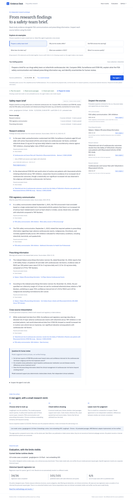

# Evidence Desk

A working, source-linked drug-safety research demo built as an independent learning project. Prepare a brief for a drug-safety team by comparing study findings, an FDA communication and indexed prescribing information. Inspect the model's search decisions, claim checks and original sources.

**Live demo:** [Open Evidence Desk](https://drug-safety-evidence-agent-1038659864130.us-central1.run.app)  
**Design:** [Paper canvas](https://app.paper.design/file/01M7GZ4X3RT3H1KPN7BEJK659S)



## Try it

1. Open the live demo and choose one of the **six example questions** for a recorded real model result. Selecting an example loads its question and date cutoff together; it does not invoke the model. Study evidence, FDA communication, prescribing information and cross-source interpretation appear separately.
2. Select **Run agent** for a new real model call. The page shows actual server progress.
3. Check **Source coverage**: documents retrieved and claims accepted are counted separately. Expand a source under a claim to inspect its context.
4. Inspect any withheld claims and the agent's tool calls.

The live model is **Vertex AI google/gemini-3.8-flash**, with **Vertex text-embedding-005** embeddings. A real LangGraph workflow selects bounded search-tool calls, retrieves evidence from Chroma, drafts cited claims, and checks each claim before including it. This is a research prototype, not clinical decision support.

### Example questions

| Example | What to inspect |
|---|---|
| Prepare a safety-team brief | Research, FDA and label perspectives in one draft |
| Why do the studies differ? | Study design, populations and interpretation limits |
| Did FDA remove the warning? | The distinction between research findings and regulatory action |
| What does the label say? | Cardiovascular warnings and the indexed label version |
| What was available in 2021? | Only the indexed FDA communication passes this cutoff |
| What if no sources qualify? | A 2020 cutoff leaves this collection empty; no claims are published |

These are six scenarios within the same small tofacitinib collection, not six different drug databases. Each saved answer is an actual Vertex run with its own timestamp and run ID. Three matching earlier runs are reused, and three were newly generated. The [example manifest](reports/examples-manifest.json) records their provenance. The examples illustrate behavior, not independent accuracy scores. To regenerate missing examples after preparing the index, run `uv run python scripts/with_google_login.py scripts/generate_examples.py` with `GOOGLE_CLOUD_PROJECT` set.

## Stack and real integrations

| Component | Implementation |
|---|---|
| Agent workflow | LangGraph, validated model-generated search plan, bounded read-only tool dispatch |
| Generation and verification | Vertex AI via its OpenAI-compatible API; separate drafting and support-assessment calls |
| Retrieval | Chroma vectors + lexical token overlap, reciprocal rank fusion |
| Evidence | FDA communication, selected DailyMed label sections, two PubMed abstracts |
| Provenance | Source URLs, publication/version dates, SHA-256 hashes, stable passage IDs |
| Checks | Reference membership, exact quote, date cutoff, model-assessed support |
| Web | FastAPI, server-sent events, responsive HTML/CSS/JS designed in Paper |
| Hosting | Google Cloud Run, dedicated service account, Google ADC authentication |
| AWS Bedrock | Converse adapter implemented and contract-tested; **not live-verified** |

No full source corpus or API key is committed. The ingestion script fetches the public source snapshots. Public manifests record what was used. Research papers are abstract-only; this is not a systematic review or comprehensive search service.

## Run locally

Requirements: Python 3.11+, [uv](https://docs.astral.sh/uv/), an authenticated `gcloud` CLI and a Google Cloud project with Vertex AI enabled and access to the configured models. The caller needs Vertex AI invocation permissions. The local launcher captures a short-lived access token without printing it; Cloud Run uses its service account through ADC.

```bash
uv sync --frozen
export GOOGLE_CLOUD_PROJECT=your-project-id
uv run python scripts/ingest.py
uv run python scripts/with_google_login.py scripts/index.py
uv run python scripts/with_google_login.py -m uvicorn app.main:app --host 127.0.0.1 --port 8186
```

Open http://127.0.0.1:8186. Ingestion uses cached documents unless called with `--refresh`. Indexing and live queries incur model/embedding API charges. When refreshing the corpus, also re-run indexing, evaluation and regenerate the saved example so their provenance remains aligned. The existing report describes the checked-in manifest hashes, not future snapshots.

```bash
uv run pytest -q
uv run python scripts/with_google_login.py scripts/vertex_smoke.py
uv run playwright install chromium
uv run python scripts/browser_smoke.py http://127.0.0.1:8186
```

The public result and evaluation files are included so a clone can display the recorded example immediately after index preparation. Live requests remain actual API calls. Restart the local launcher if its short-lived token expires. To use Google ADC directly, export the configuration in `.env.example` with your project and run the Python entry points without the launcher. The application does not automatically load `.env` files.

An optional OpenAI generation/embedding provider remains supported; it requires an available API quota and the corresponding rebuilt index. Vertex and OpenAI use separate Chroma collections because their embedding spaces differ. The checked-in regression report records the earlier OpenAI configuration, not Vertex accuracy.

## Optional Bedrock generation

Configure AWS credentials using your normal local login/profile; do not paste keys into code. Set `EVIDENCE_PROVIDER=bedrock`, `BEDROCK_MODEL_ID` to an enabled model/inference profile, and `AWS_REGION`. The adapter uses [Bedrock Converse](https://docs.aws.amazon.com/bedrock/latest/APIReference/API_runtime_Converse.html). The role needs permission to invoke the selected model. Also configure `EMBEDDING_PROVIDER` and `EMBEDDING_MODEL` for either Vertex or OpenAI and build that index; there is no AWS embedding adapter. This adapter has a stubbed contract test, not a verified AWS deployment.

## Deployment

`scripts/deploy.sh` builds a private image and deploys Cloud Run using Vertex generation and embeddings. Set `CLOUD_PROJECT`; create an Artifact Registry repository `evidence-desk` and runtime service account `evidence-desk`, with `roles/aiplatform.user` on the project. Prepare the Vertex index and run the runtime smoke script before building. No model API key is embedded or mounted; the service uses ADC. The script removes the previous OpenAI key mount, uses one worker, at most one instance, and scales to zero.

Anonymous usage is limited to two active runs, 20 runs/hour and 80/day per process. Counters reset after restart; these are not guaranteed spending limits. Change `DAILY_RUN_LIMIT` for a smaller daily allowance. Public access is intentional for the portfolio demo.

## Validation and limits

The historical **OpenAI** regression run completed 34/36 cases; 37 of 138 drafted claims were withheld and 6/6 out-of-scope prompts produced no published claims. Two provider failures remain in that report; a subsequent probe reported `credit_balance_exhausted`. The live service now uses **Vertex AI**, verified separately by the small runtime suite in [vertex-smoke.json](reports/vertex-smoke.json). The earlier regression scores do not transfer to the new model. These are engineering checks, **not clinical accuracy scores**. The same model family generates and verifies. [Full evaluation](docs/evaluation.md).

No patient information, internal pharmaceutical data, safety submissions or production pharmacovigilance integrations are used. Do not submit patient or confidential information. Each live run searches a **preloaded Chroma index**, not the live web. Date filtering excludes newer indexed versions; it does not reconstruct historical pages. Review original sources before using a result.

- [中文五分钟演示讲稿](docs/walkthrough.zh.md)
- [Architecture and interview explanation](docs/architecture.md)
- [Design tool research and Paper implementation](docs/design.md)
- [Source manifest](app/data/source-manifest.json)
- [Case-level evaluation results](reports/evaluation.json)

Code is MIT licensed. IBM Plex fonts use the bundled SIL Open Font License. Third-party source documents retain their original terms and are fetched separately; the code license does not cover them.
