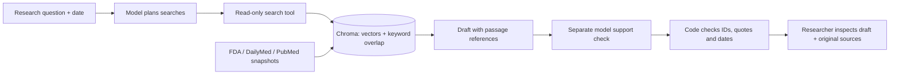

# How it works

Imagine a safety scientist asking why two studies seem to disagree. The agent helps assemble a reviewable evidence draft; the scientist remains responsible for interpreting it.

**LangGraph** owns the explicit plan → retrieve → draft → verify → finalize state graph. The model proposes search queries and source types through a validated structured plan. In safety-brief mode, a coverage policy ensures one bounded search each for research, FDA communication and prescribing information; a missing typed query uses the user question. This policy is included in the trace. Python dispatches these tool calls. This is constrained agentic retrieval, not an autonomous open-ended browser agent or a native provider tool-call loop.

**RAG** supplies external evidence to generation. `text-embedding-3-small` embeds the question and source passages. Chroma returns vector neighbors; a lexical token-overlap ranking is combined with vector ranking using reciprocal rank fusion. It is not BM25. Publication-date and source-type filters apply before retrieval. The collection contains four selected sources, not the full literature.

An English-language scope gate rejects common personal risk and treatment requests before model planning. It is a conservative heuristic with possible false positives, not a complete medical intent classifier; the model also assesses scope.

**Verification** has two layers. A fresh model call assesses whether each cited passage supports its claim, including population, comparator and uncertainty. Deterministic code rejects missing references, absent or nonmatching quotes, future-dated references, wrong source categories, and missing/ambiguous verifier verdicts. Regulatory and label sections require the matching source type; cross-source interpretation requires research plus FDA or label evidence. Source coverage counts retrieved documents separately from claims that passed. OpenAI structured outputs enforce the response schema; verification failures continue to withhold claims. The verifier is the same model family as the drafter, so errors can be correlated. This is not proof of truth, a clinical validation, or a pharmacovigilance compliance system.

**The website** is FastAPI plus plain HTML/CSS/JavaScript designed in Paper. Server-sent events expose actual workflow progress. Only public result objects reach the browser, not complete source passages, credentials or internal state. Researchers can open original sources. Excerpts are restricted to 20 words per source per result. A saved result is a recorded real model run; it is not presented as a new invocation.

**The live provider** is OpenAI, explicitly displayed. An AWS Bedrock Converse adapter uses the standard boto3 credential chain and is covered by a request-contract test. AWS access was not configured for this build, so the repository does not claim live Bedrock execution. Embeddings still use OpenAI even if the generation provider switches to Bedrock. A full AWS-only migration would also need an embedding adapter and a rebuilt index.

**Hosting** uses Cloud Run with a dedicated service account and a Secret Manager key. The prepared index is baked into a private container image; no raw-document API is exposed. Anonymous runs have two in-process slots and global hourly/daily quotas. These counters reset at restart, so they are usage controls, not a hard spending cap. One process per instance is required. Maximum instances is one, minimum zero.

## Scope and limitations

- No adverse-event case intake, patient data, FAERS signal detection, safety submission or hospital integration.
- Two research abstracts are indexed; no assertion of a comprehensive full-text systematic review.
- The current label snapshot cannot be reconstructed as it existed on any historical date. A date cutoff filters available versions only.
- No automatic external action. A draft can still be incomplete or wrong and requires source review. Model-generated review prompts are not passed through the claim verifier. They are requested as neutral questions and labeled separately from verified claims.
- Questions are sent to the configured model/embedding providers. Do not enter confidential or patient information. The app does not persist live questions; hosting/platform logs follow the account's configuration.
- An interrupted browser request does not cancel an in-flight model call. Bounded calls finish server-side.

## Interview explanation

“I built an independent research prototype to practice source-grounded agent workflows. It retrieves dated public regulatory and study evidence, drafts cited claims, and separates mechanical citation checks from a model-based support assessment. I tested abstention and date filtering and kept the evaluation limits explicit. The live version uses OpenAI; the Bedrock adapter is implemented but I have not yet verified it against an AWS account.”

This demonstrates applied prototyping, retrieval, provenance and evaluation work. It does not establish professional pharmacovigilance experience or production AWS experience.

## Safety-brief update

The default question now requests a brief for a drug-safety team. The UI separates research evidence, FDA communication, indexed prescribing information, and cross-source interpretation, with review prompts below. Missing or fully withheld sections remain visible as gaps. This changes the analysis organization and provenance checks; it does not add live web browsing. The source index remains preloaded and the UI labels it accordingly.
